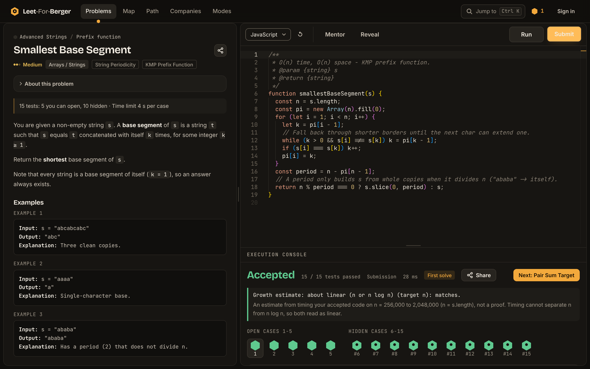
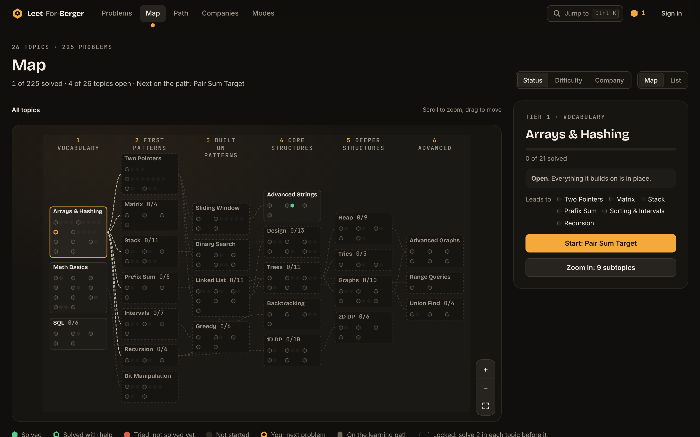
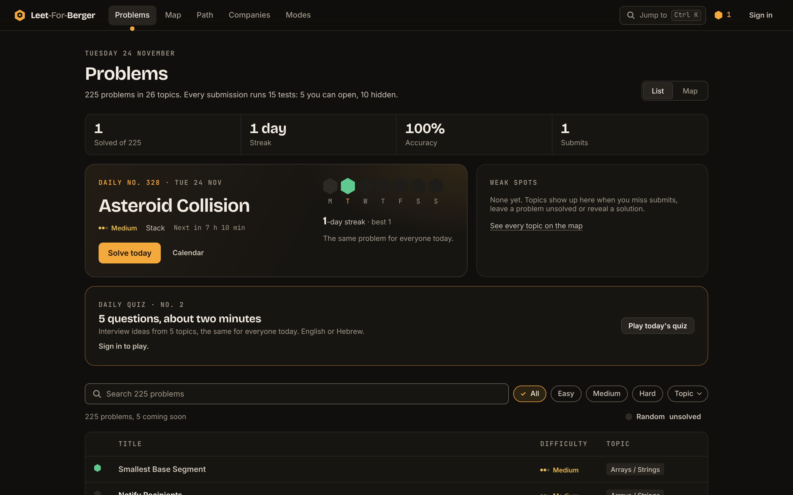
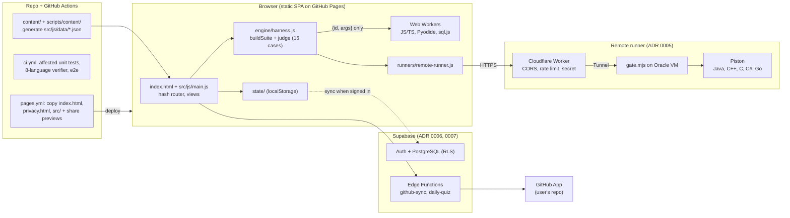

<div align="center">


# Leet-For-Berger

**Free LeetCode-style interview practice: write code in 8 languages, get judged on 15 tests, and follow a map from easy to hard.**

[](https://github.com/Royc4515/leet-for-berger/actions/workflows/ci.yml)
[](https://github.com/Royc4515/leet-for-berger/actions/workflows/pages.yml)
[](https://royc4515.github.io/leet-for-berger/)
[](package.json)
[](LICENSE)
[](https://github.com/Royc4515/leet-for-berger/commits/main)

**[Open the live site](https://royc4515.github.io/leet-for-berger/)**



</div>

## Contents

- [About](#about)
- [Features](#features)
- [Tech stack](#tech-stack)
- [Architecture](#architecture)
- [Project structure](#project-structure)
- [Getting started](#getting-started)
- [Adding a problem](#adding-a-problem)
- [Deploying](#deploying)
- [Roadmap and known limits](#roadmap-and-known-limits)
- [Contributing](#contributing)
- [License](#license)
- [Author](#author)

## About

**The goal.** One place to prepare for a technical interview or take-home test, from easy to hard, in any common language, with feedback you can trust, at no cost. For students and developers before interviews, including at Israeli companies.

**The approach.** A static site that judges every submission on the same 15 tests, runs 8 languages, and orders 225 problems into a learning network: 26 topics, prerequisites between them, and a ladder from easy to hard inside each one. It is built around trustworthy feedback: every shipped solution is verified in CI in all 8 languages, and hidden test data never reaches the browser's UI.

## Features

- **15-case judge.** 5 visible cases with full detail, 10 hidden pass/fail cases, a per-case time limit and LeetCode-style verdicts ([`harness.js`](src/js/engine/harness.js)).
- **8 languages.** JavaScript, TypeScript and Python run in the browser (Web Worker, [Pyodide](https://pyodide.org)); SQL runs on [sql.js](https://sql.js.org); Java, C++, C, C# and Go run on a remote runner ([ADR 0005](docs/adr/0005-remote-runner.md)). Starter code is generated from one typed signature ([`codegen.js`](src/js/engine/codegen.js)).
- **Problem Map.** One continuous map you zoom into, from 26 topics down to a single problem, with prerequisite roads and lock reasons ([ADR 0010](docs/adr/0010-problem-map-rendering.md)).
- **Learning path.** 131 essential problems, one per subtopic, in six tiers.
- **Company practice.** Problem sets per company, including a Jobs in Israel view with careers links.
- **Daily challenge and daily quiz.** The same problem for everyone each day, a 16-week calendar, and a 5-question quiz (English or Hebrew) with a leaderboard.
- **Modes.** 45-minute interview simulator with a report, mock online assessment, battle against a bot, and a scripted Socratic mentor.
- **Complexity feedback.** After an Accepted run, your code is timed on growing inputs and the growth is compared to the target ([ADR 0004](docs/adr/0004-complexity-feedback.md)).
- **Accounts (optional).** Sign in to sync progress across devices and push each accepted solution to your own GitHub repo ([ADR 0006](docs/adr/0006-accounts-and-sync.md), [ADR 0007](docs/adr/0007-github-sync.md)).

<table>
  <tr>
    <td></td>
    <td></td>
  </tr>
  <tr>
    <td align="center">Problem Map</td>
    <td align="center">Problems and daily challenge</td>
  </tr>
</table>

## Tech stack

| Layer | Technology |
|---|---|
| App | Vanilla JavaScript ES modules, HTML, CSS. No framework, no bundler ([ADR 0001](docs/adr/0001-no-build-step.md)) |
| Editor | [Monaco Editor](https://microsoft.github.io/monaco-editor/) 0.52.2 |
| In-browser runtimes | Web Workers, [Pyodide](https://pyodide.org) 0.27.2, [sql.js](https://sql.js.org) 1.13.0, TypeScript through Monaco's TypeScript service |
| Remote runner | [Piston](https://github.com/engineer-man/piston) on an Oracle Always Free VM, behind a [Cloudflare Worker](https://developers.cloudflare.com/workers/) |
| Accounts and data | [Supabase](https://supabase.com) (Auth, PostgreSQL with Row Level Security, Edge Functions), supabase-js 2.118.0 |
| Hosting | GitHub Pages, deployed by GitHub Actions |
| Testing | `node --test`, [Playwright](https://playwright.dev) smoke test, an 8-language solution verifier in CI |
| Fonts | Bricolage Grotesque, Inter, JetBrains Mono, self-hosted ([`src/fonts/`](src/fonts/README.md)) |

CDN versions are pinned and checked by a test ([`tests/cdn-pins.test.js`](tests/cdn-pins.test.js)).

## Architecture



- **Judging is pure and separate from execution.** The harness builds the 15 cases, sends workers only `{ id, args }`, and judges the raw outputs itself. Expected values never reach user code, and hidden case data never reaches the UI.
- **Untrusted code never runs on the main thread.** Each run is in a Web Worker with a per-case watchdog, so an infinite loop costs one worker, not the tab.
- **One set of test programs.** The native programs in [`src/js/engine/programs/`](src/js/engine/programs/) are used both by the remote runner and by the CI verifier, so a solution that passes CI passes on the site.
- **Problems load lazily.** A generated catalog feeds the listing views; one problem module loads on demand ([ADR 0008](docs/adr/0008-lazy-problem-modules.md)).

Full write-up: [`docs/ARCHITECTURE.md`](docs/ARCHITECTURE.md). Design system: [`docs/DESIGN.md`](docs/DESIGN.md).

## Project structure

```text
.
├── index.html, privacy.html   the two pages GitHub Pages serves
├── src/
│   ├── css/app.css            all styles, Atlas design tokens at the top
│   ├── fonts/, brand/         self-hosted fonts, logo, company logos
│   └── js/
│       ├── main.js            bootstrap and hash router
│       ├── config.js          public site config (runner URL, Supabase public key)
│       ├── engine/            judge, code generation, runners, workers, native test programs
│       ├── problems/<id>/     one folder per problem: problem.js + solutions in 8 languages
│       ├── data/              taxonomy, map layout, company sets, daily maths, quiz index
│       ├── modes/             interview, battle, mock OA, quiz session logic
│       ├── state/             progress, drafts, cross-device merge
│       ├── auth/              Supabase sign-in, sync, GitHub sync
│       ├── mentor/            scripted mentor
│       └── ui/                DOM helpers, editor, views
├── tests/                     node --test unit tests, one file per problem + infrastructure
├── e2e/smoke.mjs              Playwright smoke test (fails on any console error)
├── content/                   problem index, ladders, families, company data, quiz bank
├── scripts/                   content builds, CI test selection, verifier, share previews, dev server
├── deploy/                    Cloudflare Worker, Piston VM kit, Supabase functions and migrations
├── db/schema.sql              PostgreSQL schema
└── docs/                      architecture, design, plan, deploy guides, ADRs
```

[`CLAUDE.md`](CLAUDE.md) has the file-by-file map.

## Getting started

### Prerequisites

- [Node.js](https://nodejs.org) 20 or newer (CI uses 22).
- For the e2e test: a Chromium for Playwright (`npx playwright install chromium`), or a local Chrome (see below).
- Optional, to verify solutions locally in every language: Python 3, gcc/g++, Java 21, .NET 8 and Go 1.23. Missing toolchains are skipped locally.

### Install and run

```bash
git clone https://github.com/Royc4515/leet-for-berger.git
```

```bash
cd leet-for-berger
```

```bash
npm install
```

```bash
npm run dev
```

Open <http://localhost:5173>. The app itself needs no install; `npm install` only adds the dev tools (Playwright, TypeScript, sql.js). It must be served over HTTP, not opened as a file, because ES modules and workers need it.

### Test

| Command | What it runs |
|---|---|
| `npm test` | All unit tests, including the solution verifier for every language whose toolchain is installed (slow: it compiles every solution) |
| `VERIFY_LANGUAGES=none npm test` | Unit tests without the solution verifier (about 2 minutes) |
| `npm run test:affected` | Only the unit tests your branch's changes reach, as CI picks them |
| `npm run test:e2e` | Playwright smoke test: Monaco, workers, Pyodide, routing, zero console errors |
| `npm run check` | Unit tests and e2e, run before every commit |
| `npm run check:db` | Schema and git -> database sync against a throwaway PostgreSQL (needs PostgreSQL binaries) |

### Configuration

No `.env` file is used. Public site settings (remote runner URL, Supabase URL and publishable key) live in [`src/js/config.js`](src/js/config.js); an empty runner URL makes the remote languages editor-only, and an empty Supabase URL hides sign-in. Server secrets are set on the services themselves (see [Deploying](#deploying)).

The dev scripts read these optional environment variables:

| Variable | Used by | Effect |
|---|---|---|
| `VERIFY_LANGUAGES` | `tests/solutions.test.js` | Comma list of languages to verify (`java,go`, `sql`, or `none`) |
| `REQUIRE_ALL_LANGUAGES=1` | `tests/solutions.test.js` | Fail instead of skipping when a toolchain is missing (CI sets it) |
| `PW_CHANNEL=chrome` | e2e, share previews | Use the installed Google Chrome instead of Playwright's Chromium |
| `PW_EXECUTABLE=/path/to/chrome` | e2e, share previews | Use a specific browser binary |
| `PORT` | `scripts/serve.mjs` | Dev server port (default 5173) |

The smoke test also takes `--no-python` (skip the Pyodide download) and `--shots=<dir>` (save screenshots).

## Adding a problem

Every problem is a folder in [`src/js/problems/`](src/js/problems/) with a statement, a typed signature, a reference, a seeded generator for the hidden tests and a verified solution in each of the 8 languages. The format and checklist are in [`docs/PROBLEM_FORMAT.md`](docs/PROBLEM_FORMAT.md); the content pipeline is in [`content/README.md`](content/README.md).

## Deploying

- **Site.** Push to `main`. [`pages.yml`](.github/workflows/pages.yml) copies `index.html`, `privacy.html` and `src/` into the Pages artifact, adds the share preview pages, and deploys.
- **Remote runner.** [`docs/DEPLOY_RUNNER.md`](docs/DEPLOY_RUNNER.md): Piston VM, Cloudflare Tunnel and Worker. [`runner-health.yml`](.github/workflows/runner-health.yml) checks it every 6 hours.
- **Accounts.** [`docs/DEPLOY_AUTH.md`](docs/DEPLOY_AUTH.md): Supabase project, schema, OAuth providers.
- **GitHub sync.** [`docs/DEPLOY_GITHUB_SYNC.md`](docs/DEPLOY_GITHUB_SYNC.md): the GitHub App and its Edge Function.

## Roadmap and known limits

The living plan is [`docs/PLAN.md`](docs/PLAN.md); the phase checklist is [`docs/ROADMAP.md`](docs/ROADMAP.md). Known limits, by design until a backend takes over judging:

- **Solutions ship in the client bundle.** "Reveal solution" asks for confirmation and marks the problem as assisted, but true secrecy needs server-side judging.
- **Remote languages are practice-only.** Java, C++, C, C# and Go are judged in practice mode; interview and battle keep them editor-only until scored sessions are judged on the server.
- **The remote runner is free-tier.** It is one Always Free VM behind a Worker (100,000 requests a day, two jobs at a time). When it is down the page says so; it never fakes a verdict.
- **Battle is bot-only and the mentor is scripted.** Live battles and an LLM mentor need a backend proxy.
- **SQL runs on SQLite**, not LeetCode's MySQL dialect.

## Contributing

See [`CONTRIBUTING.md`](CONTRIBUTING.md) for the workflow, the invariants every change must keep, and the definition of done. Bugs and ideas go in [issues](https://github.com/Royc4515/leet-for-berger/issues).

## License

[MIT](LICENSE), except files adapted from third-party sources, which keep their own licenses: solutions marked `doocs/leetcode` are CC BY-SA 4.0. Details and the fonts' licenses: [`THIRD_PARTY_NOTICES.md`](THIRD_PARTY_NOTICES.md).

## Author

**Roy Carmelli**, Computer Science and Brain Sciences student at Bar-Ilan University.

[GitHub](https://github.com/Royc4515) · [LinkedIn](https://linkedin.com/in/roy-carmelli) · [Portfolio](https://roy-carmelli-portfolio.vercel.app/)
