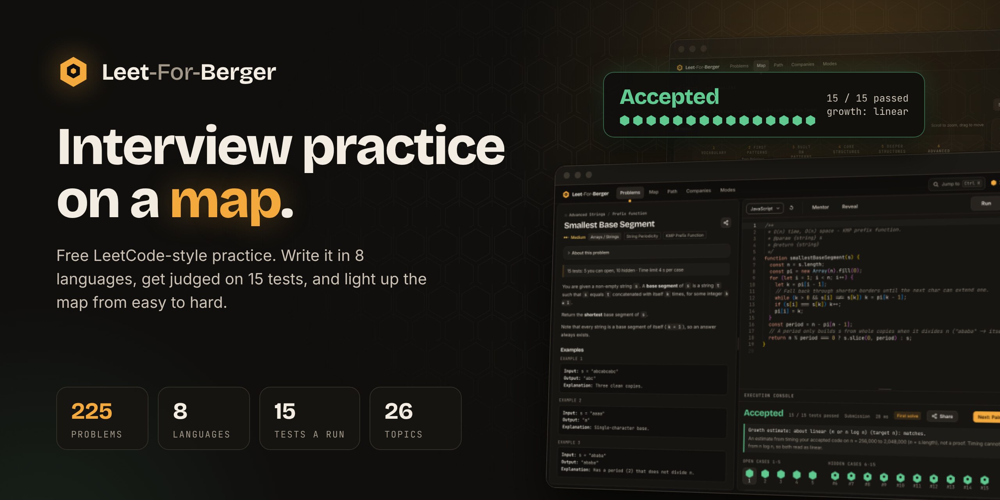
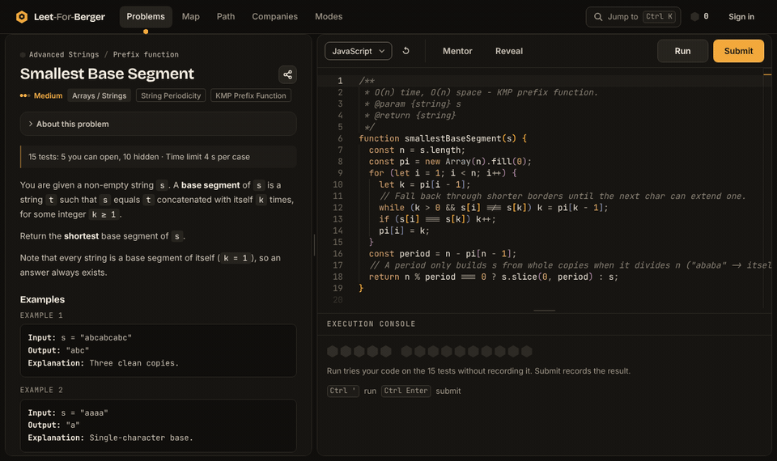
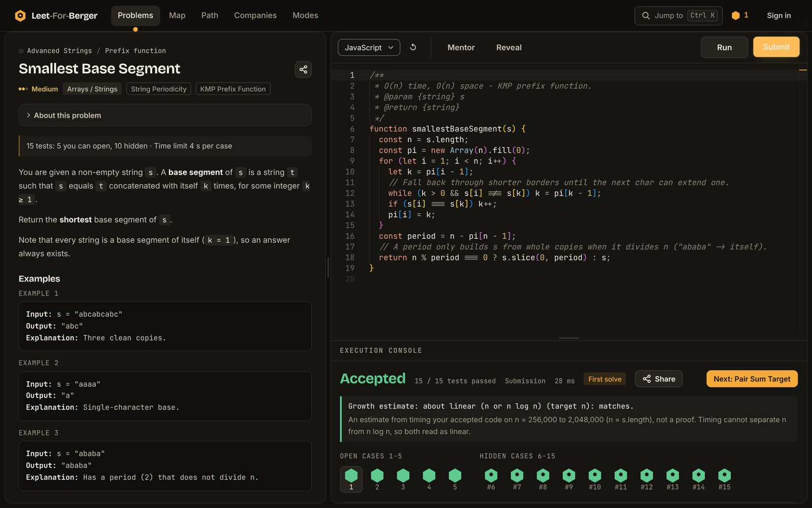
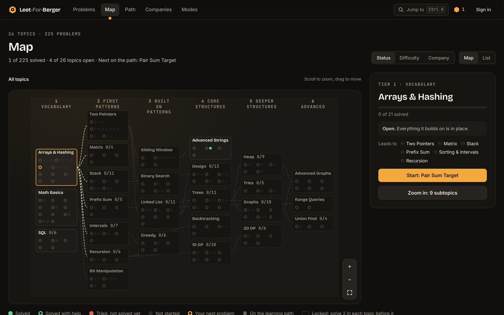
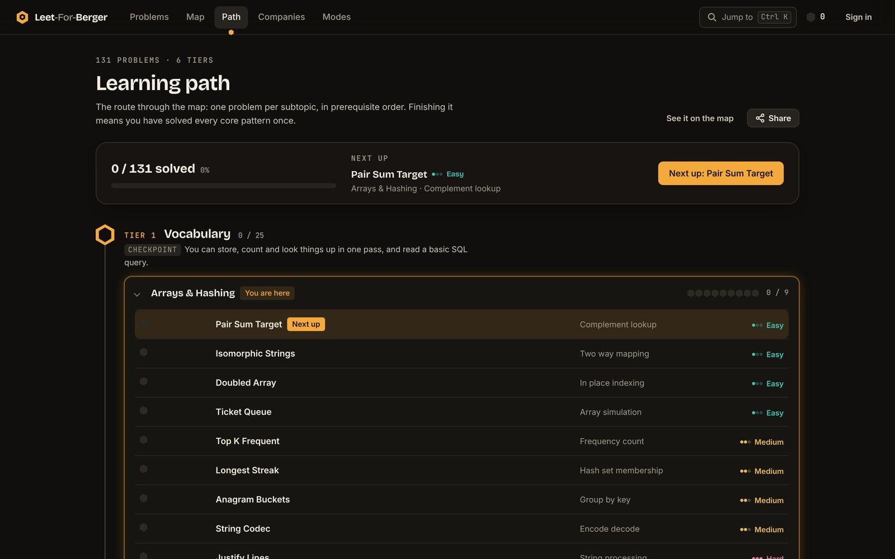
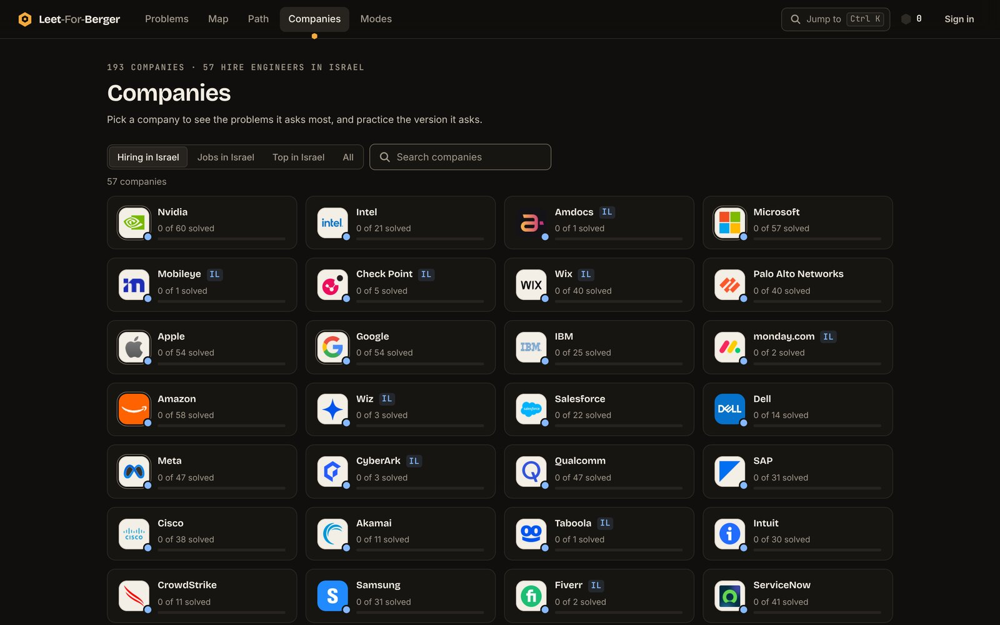
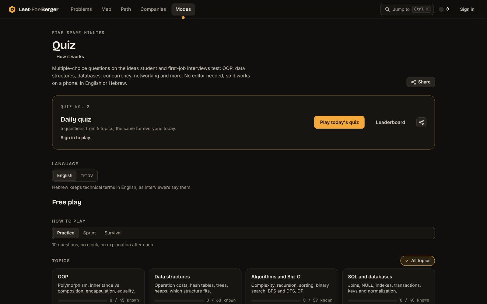
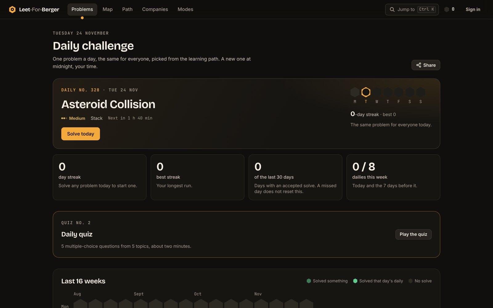
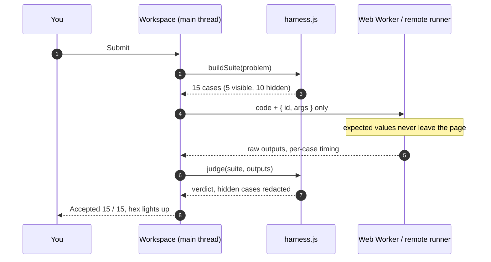
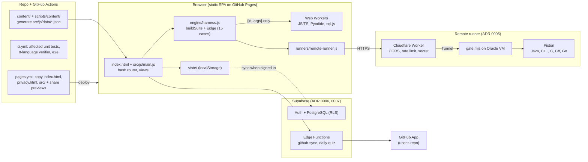

<a href="https://royc4515.github.io/leet-for-berger/">
  
</a>

<div align="center">

[](https://github.com/Royc4515/leet-for-berger/actions/workflows/ci.yml)
[](https://github.com/Royc4515/leet-for-berger/actions/workflows/pages.yml)
[](LICENSE)
[](https://github.com/Royc4515/leet-for-berger/commits/main)

### [**Open the live site →**](https://royc4515.github.io/leet-for-berger/)

Free. No sign-up needed to practice. Runs in your browser.

[Features](#features) · [How it works](#how-it-works) · [Quick start](#quick-start) · [Architecture](#architecture) · [Docs](#docs)

</div>

<br>

<div align="center">
  
  <br>
  <sub>Submit, get judged on 15 tests, watch your hex light up on the map.</sub>
</div>

<br>

<table align="center">
  <tr>
    <td align="center" width="16%"><h2>225</h2><sub>PROBLEMS</sub></td>
    <td align="center" width="16%"><h2>8</h2><sub>LANGUAGES</sub></td>
    <td align="center" width="16%"><h2>15</h2><sub>TESTS A RUN</sub></td>
    <td align="center" width="16%"><h2>26</h2><sub>TOPICS</sub></td>
    <td align="center" width="16%"><h2>193</h2><sub>COMPANIES</sub></td>
    <td align="center" width="16%"><h2>526</h2><sub>QUIZ QUESTIONS</sub></td>
  </tr>
</table>

## Why it exists

One place to prepare for a technical interview or a take-home test: from easy to hard, in any common language, with feedback you can trust, at no cost. Built for students and developers before interviews, including at Israeli companies.

<table>
  <tr>
    <td width="33%" valign="top">
      <h3>A judge you can trust</h3>
      Every run executes exactly 15 tests: 5 you can open, 10 hidden. Every shipped solution is verified in CI in all 8 languages, and hidden test data never reaches your browser's UI.
    </td>
    <td width="33%" valign="top">
      <h3>A map, not a list</h3>
      26 topics with prerequisites, a ladder from easy to hard inside each one, and a 131-problem learning path. Every solve lights a hex.
    </td>
    <td width="33%" valign="top">
      <h3>Practice like the real thing</h3>
      Problem sets per company, a 45-minute interview simulator, a mock online assessment, a daily challenge and a daily quiz with a leaderboard.
    </td>
  </tr>
</table>

## Features

<table>
  <tr>
    <td width="50%" valign="top">
      
      <h4>The workspace</h4>
      Monaco editor, 5 visible and 10 hidden tests, LeetCode-style verdicts, and a growth estimate that times your accepted code on bigger and bigger inputs.
    </td>
    <td width="50%" valign="top">
      
      <h4>The Problem Map</h4>
      One continuous map you zoom into, from 26 topics down to a single problem, with prerequisite roads and a reason for every lock.
    </td>
  </tr>
  <tr>
    <td width="50%" valign="top">
      
      <h4>The learning path</h4>
      131 essential problems, one per subtopic, in six tiers. Finish it and you have solved every core pattern once.
    </td>
    <td width="50%" valign="top">
      
      <h4>Practice by company</h4>
      193 companies, the version of each problem they ask, and an Israel view: who is hiring engineers there, with careers links.
    </td>
  </tr>
  <tr>
    <td width="50%" valign="top">
      
      <h4>The quiz</h4>
      526 multiple-choice questions in 18 topics, in English or Hebrew. A daily quiz with a leaderboard, plus practice, sprint and survival modes.
    </td>
    <td width="50%" valign="top">
      
      <h4>Daily challenge</h4>
      The same problem for everyone each day, streaks, and a 16-week calendar of what you solved.
    </td>
  </tr>
</table>

<details>
<summary><b>And more</b></summary>

<br>

- **8 languages.** JavaScript, TypeScript and Python run in the browser (Web Worker, [Pyodide](https://pyodide.org)); SQL runs on [sql.js](https://sql.js.org); Java, C++, C, C# and Go run on a remote runner ([ADR 0005](docs/adr/0005-remote-runner.md)). Starter code is generated from one typed signature ([`codegen.js`](src/js/engine/codegen.js)).
- **Modes.** A 45-minute interview simulator with a report, a mock online assessment, a battle against a bot, and a scripted Socratic mentor.
- **Complexity feedback.** After an Accepted run your code is timed on growing inputs, and the growth is compared to the target ([ADR 0004](docs/adr/0004-complexity-feedback.md)).
- **Accounts (optional).** Sign in to sync progress and the quiz across devices, and push each accepted solution to your own GitHub repo ([ADR 0006](docs/adr/0006-accounts-and-sync.md), [ADR 0007](docs/adr/0007-github-sync.md)).
- **Command palette.** `Ctrl` + `K` searches problems, topics, companies and pages.

</details>

## How it works



- **Judging is pure and separate from execution.** The harness builds the cases, workers see only `{ id, args }`, and the harness judges the outputs itself, so user code can't read the answers and the UI never gets hidden data.
- **Untrusted code never runs on the main thread.** Each run gets a Web Worker with a per-case watchdog, so an infinite loop costs one worker, not the tab.
- **One set of test programs.** The native programs in [`src/js/engine/programs/`](src/js/engine/programs/) are used by both the remote runner and the CI verifier, so a solution that passes CI passes on the site.

## Tech stack

<p>
  
  
  
  
  
  
  
  
  
  
  
</p>

#### Languages you can solve in

<p>
  
  
  
  
  
  
  
  
  
</p>

CDN versions are pinned and checked by a test ([`tests/cdn-pins.test.js`](tests/cdn-pins.test.js)).

## Quick start

You need [Node.js](https://nodejs.org) 20 or newer.

```bash
git clone https://github.com/Royc4515/leet-for-berger.git
```

```bash
cd leet-for-berger
```

```bash
npm install
```

```bash
npm run dev
```

Open <http://localhost:5173>. The app itself has no build step; `npm install` only adds the dev tools (Playwright, TypeScript, sql.js). It has to be served over HTTP, not opened as a file, because ES modules and workers need it.

<details>
<summary><b>Tests</b></summary>

<br>

| Command | What it runs |
|---|---|
| `npm test` | All unit tests, including the solution verifier for every language whose toolchain is installed (slow: it compiles every solution) |
| `VERIFY_LANGUAGES=none npm test` | Unit tests without the solution verifier (about 2 minutes) |
| `npm run test:affected` | Only the unit tests your branch's changes reach, as CI picks them |
| `npm run test:e2e` | Playwright smoke test: Monaco, workers, Pyodide, routing, zero console errors |
| `npm run check` | Unit tests and e2e, run before every commit |
| `npm run check:db` | Schema and git -> database sync against a throwaway PostgreSQL (needs PostgreSQL binaries) |

For the e2e test you need a Chromium for Playwright (`npx playwright install chromium`) or a local Chrome (`PW_CHANNEL=chrome`). To verify solutions locally in every language, install Python 3, gcc/g++, Java 21, .NET 8 and Go 1.23; missing toolchains are skipped locally and required in CI.

</details>

<details>
<summary><b>Configuration</b></summary>

<br>

No `.env` file is used. Public site settings (remote runner URL, Supabase URL and publishable key) live in [`src/js/config.js`](src/js/config.js). An empty runner URL makes the remote languages editor-only; an empty Supabase URL hides sign-in. Server secrets are set on the services themselves (see [Deploying](#deploying)).

| Variable | Used by | Effect |
|---|---|---|
| `VERIFY_LANGUAGES` | `tests/solutions.test.js` | Comma list of languages to verify (`java,go`, `sql`, or `none`) |
| `REQUIRE_ALL_LANGUAGES=1` | `tests/solutions.test.js` | Fail instead of skipping when a toolchain is missing (CI sets it) |
| `PW_CHANNEL=chrome` | e2e, share previews | Use the installed Google Chrome instead of Playwright's Chromium |
| `PW_EXECUTABLE=/path/to/chrome` | e2e, share previews | Use a specific browser binary |
| `PORT` | `scripts/serve.mjs` | Dev server port (default 5173) |

The smoke test also takes `--no-python` (skip the Pyodide download) and `--shots=<dir>` (save screenshots).

</details>

## Architecture



Problems load lazily: a generated catalog feeds the listing views, and one problem module loads on demand ([ADR 0008](docs/adr/0008-lazy-problem-modules.md)). The full write-up is [`docs/ARCHITECTURE.md`](docs/ARCHITECTURE.md); the design system is [`docs/DESIGN.md`](docs/DESIGN.md).

<details>
<summary><b>Project structure</b></summary>

<br>

```text
.
├── index.html, privacy.html   the two pages GitHub Pages serves
├── src/
│   ├── css/app.css            all styles, Atlas design tokens at the top
│   ├── fonts/, brand/         self-hosted fonts, logo, company logos
│   └── js/
│       ├── main.js            bootstrap and hash router
│       ├── config.js          public site config (runner URL, Supabase public key)
│       ├── engine/            judge, code generation, runners, workers, native test programs
│       ├── problems/<id>/     one folder per problem: problem.js + solutions in 8 languages
│       ├── data/              taxonomy, map layout, company sets, daily maths, quiz index
│       ├── modes/             interview, battle, mock OA, quiz session logic
│       ├── state/             progress, drafts, cross-device merge
│       ├── auth/              Supabase sign-in, sync, GitHub sync
│       ├── mentor/            scripted mentor
│       └── ui/                DOM helpers, editor, views
├── tests/                     node --test unit tests, one file per problem + infrastructure
├── e2e/smoke.mjs              Playwright smoke test (fails on any console error)
├── content/                   problem index, ladders, families, company data, quiz bank
├── scripts/                   content builds, CI test selection, verifier, share previews, dev server
├── deploy/                    Cloudflare Worker, Piston VM kit, Supabase functions and migrations
├── db/schema.sql              PostgreSQL schema
└── docs/                      architecture, design, plan, deploy guides, ADRs
```

[`CLAUDE.md`](CLAUDE.md) has the file-by-file map.

</details>

## Deploying

| Part | How |
|---|---|
| **Site** | Push to `main`. [`pages.yml`](.github/workflows/pages.yml) copies `index.html`, `privacy.html` and `src/`, adds the share preview pages, and deploys to GitHub Pages |
| **Remote runner** | [`docs/DEPLOY_RUNNER.md`](docs/DEPLOY_RUNNER.md): Piston VM, Cloudflare Tunnel and Worker. [`runner-health.yml`](.github/workflows/runner-health.yml) checks it every 6 hours |
| **Accounts** | [`docs/DEPLOY_AUTH.md`](docs/DEPLOY_AUTH.md): Supabase project, schema, OAuth providers |
| **GitHub sync** | [`docs/DEPLOY_GITHUB_SYNC.md`](docs/DEPLOY_GITHUB_SYNC.md): the GitHub App and its Edge Function |

## Known limits

By design, until a backend takes over judging:

- **Solutions ship in the client bundle.** "Reveal solution" asks for confirmation and marks the problem as assisted, but true secrecy needs server-side judging.
- **Remote languages are practice-only.** Java, C++, C, C# and Go are judged in practice mode; interview and battle keep them editor-only until scored sessions are judged on the server.
- **The remote runner is free-tier.** One Always Free VM behind a Worker: 100,000 requests a day, two jobs at a time. When it is down the page says so; it never fakes a verdict.
- **Battle is bot-only and the mentor is scripted.** Live battles and an LLM mentor need a backend proxy.
- **SQL runs on SQLite**, not LeetCode's MySQL dialect.

The living plan is [`docs/PLAN.md`](docs/PLAN.md); the phase checklist is [`docs/ROADMAP.md`](docs/ROADMAP.md).

## Docs

| Doc | What's inside |
|---|---|
| [Architecture](docs/ARCHITECTURE.md) | Execution flow, runners, judging, problem loading |
| [Design system](docs/DESIGN.md) | The Atlas tokens, components and rules |
| [Problem format](docs/PROBLEM_FORMAT.md) | How to add a problem, with tests and 8 solutions |
| [Content pipeline](content/README.md) | Problem index, ladders, families, company data |
| [Decision records](docs/adr/) | Ten ADRs, from "no build step" to the map's rendering |
| [Contributing](CONTRIBUTING.md) | Workflow, invariants, definition of done |

## License

[MIT](LICENSE), except files adapted from third-party sources, which keep their own licenses: solutions marked `doocs/leetcode` are CC BY-SA 4.0. Details and the fonts' licenses: [`THIRD_PARTY_NOTICES.md`](THIRD_PARTY_NOTICES.md).

<br>

<div align="center">

### Built by Roy Carmelli

Computer Science and Brain Sciences, Bar-Ilan University

[](https://github.com/Royc4515)
[](https://linkedin.com/in/roy-carmelli)
[](https://roy-carmelli-portfolio.vercel.app/)

<sub>If it helped you prepare, a star helps others find it.</sub>

</div>
