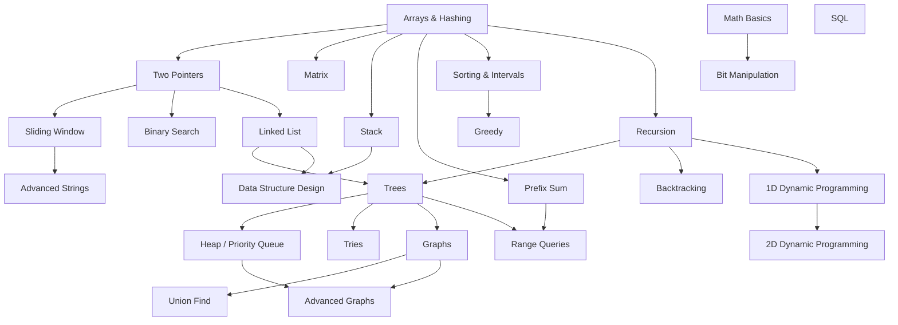

# Content

## Scope

The bank must cover every classic topic and every commonly asked company problem, with an easy on-ramp, in all common interview languages (Python, Java, C++, JavaScript; C# and Go as extras).

| Set | Rule | Size |
|---|---|---|
| Ladders | One per topic, every concept covered, easy -> hard | 225 |
| **Wave 1**, learning core | Ladders + Blind 75 + NeetCode 150 + easy classics (NeetCode Easy, or Easy asked by 8+ companies) | 356 |
| **Wave 2**, company coverage | Asked by 15+ companies, or top 30 at one of the 20 companies with the most tagged problems | +196 |
| Company versions | The family version a top company asks most (see Families) | +27 |
| **Core bank** | Everything we author | **579** |

Thresholds live in `content/selection.json`. Current numbers and coverage: `content/AUDIT.md`.

The problem bank is built as a **learning network**: topics with prerequisites, and inside each topic a ladder of problems from Easy to Hard, ordered by concept. Every practice mode (path, topic drill, mock OA, interview, company set, daily, weak spots) selects from the same data.

Source of truth for the network: `src/js/data/taxonomy.js` (validated by `tests/taxonomy.test.js`). Regenerate the graph and table below with `node scripts/taxonomy-graph.mjs`.

## Two layers

| Layer | What it holds | Where | Rule |
|---|---|---|---|
| **Index** | Facts about problems: source link, difficulty, topic, concept, lists, company signals | `content/index/` | Collect broadly. No statements, examples or tests copied from other platforms |
| **Content** | What the app runs: our own statement, 15 tests, 3 solutions | `src/js/problems/<id>.js` | Original writing only. See `docs/PROBLEM_FORMAT.md` |

Why: a problem idea is free to reuse, its exact wording is not. The index points at the idea; the content layer keeps the same problem and re-expresses it in our own words and tests (e.g. `pair-sum-target` for "Two Sum").

## Index record

`content/index/problems.json` is generated, never edited by hand:

```bash
bash scripts/content/fetch-sources.sh   # datasets -> content/.cache (gitignored)
node scripts/content/build-index.mjs    # -> content/index/problems.json (applies content/ladders.json)
node scripts/content/audit.mjs          # -> content/AUDIT.md
```

One record per problem, one record per line, sorted by `priority`:

```json
{
  "slug": "two-sum", "number": 1, "title": "Two Sum",
  "difficulty": "Easy", "rating": 2, "contestRating": null,
  "topic": "arrays-hashing", "concept": "complement-lookup",
  "tags": ["Array", "Hash Table"], "estMinutes": 15,
  "url": "https://leetcode.com/problems/two-sum/",
  "lists": ["blind75", "neetcode150", "neetcode-all"],
  "companyCount": 113,
  "companies": [{ "name": "Google", "frequency": 100, "recency": "30d" }],
  "priority": 0.844,
  "ladderStep": 3, "wave": 1, "core": ["ladder", "classic", "easy-classic", "company-common"],
  "contentId": "pair-sum-target", "status": "selected"
}
```

`status` is `selected` for every core-bank problem.

| Field | Meaning |
|---|---|
| `topic`, `concept` | Place in the network. NeetCode's pattern wins when present, otherwise the most specific LeetCode tag (rules in `build-index.mjs`). `concept` is null until a problem is selected for a ladder |
| `rating` | 1-10 inside the band of `difficulty` (Easy 1-3, Medium 4-7, Hard 8-10). Positioned by `contestRating` when the problem appeared in a contest, otherwise the band middle |
| `estMinutes` | Time budget for Mock OA and Interview |
| `companies` | Per company: `frequency` (0-100, all time) and `recency`, the newest window it was asked in (`30d`, `3m`, `6m`, `older`) |
| `priority` | 0-1: 50% how many companies ask it, 30% curated list membership, 20% share of companies asking it recently |
| `ladderStep` | Position on its topic's ladder (0 = first), null when not selected |
| `wave`, `core` | Core bank membership: `wave` 1 or 2 (null = index only), `core` lists why (`ladder`, `classic`, `easy-classic`, `company-common`, `company-version`) |
| `family` | Family id from `content/families.json`, or null |
| `contentId`, `status` | Link to `src/js/problems/<contentId>.js`. `indexed` -> `selected` -> `authored` -> `verified`; only `verified` ships |

Content we write keeps the problem (same task, same constraints, same diversity) and rewrites the statement, examples and tests in our own words.

## Sources

| Source | Take | Allowed |
|---|---|---|
| LeetCode | Link, number, title, difficulty (via the datasets) | No direct scraping needed |
| Blind 75 / NeetCode 150 / Grind 75 | Membership | Yes, lists of names |
| Community company-tag datasets on GitHub | Company, frequency, recency | Yes, used in the index and Company Set mode |
| Contest rating datasets | Numeric difficulty to seed `rating` | Yes, as a number |
| Exercism problem-specifications (MIT) | Statements and canonical tests | Yes, with attribution |
| Interview reports (Israeli companies, etc.) | Topic and difficulty signal | Manual, our own summary |

## Families and versions

`content/families.json` groups problems that share one solution idea, where each version changes one thing (the `twist`): sorted input, a circular array, parent pointers, k instead of 1. 79 families cover 222 problems.

- The first member is canonical: the default for anyone not targeting a company.
- `pickVersion(family, company, frequencyOf)` in `src/js/data/families.js` returns the version that company asks most. Meta, for example, gets Lowest Common Ancestor III, Basic Calculator II and Minimum Remove to Make Valid Parentheses where Google gets the originals.
- Every version a top-20 company would be shown is pulled into the core bank (`core` reason `company-version`).
- Ladders keep the member chosen for teaching. Version swapping applies where a company is the target: Company Set, Mock OA, Interview.
- Each index record carries `family` (null when it has none).

What makes a family: same core technique, one stated twist. A shared name is not enough (Two Sum IV is a tree problem, Jump Game V is DP), so families are curated by hand, not generated.

Source limit: company data comes from LeetCode tags only. Versions from other sites (HackerRank, CodeSignal) need another source.

## Learning network



| Tier | Topic | Easy | Medium | Hard | Concepts (in ladder order) |
|---|---|---|---|---|---|
| 0 | Arrays & Hashing | 4 | 5 | 2 | frequency-count, hash-set-membership, complement-lookup, group-by-key, encode-decode |
| 0 | Math Basics | 3 | 4 | 3 | digit-manipulation, modular-arithmetic, gcd-lcm, prime-sieve, fast-power, combinatorics, geometry, game-theory |
| 0 | SQL | 4 | 5 | 3 | select-filter, joins, group-by-aggregation, subqueries, window-functions |
| 1 | Two Pointers | 3 | 4 | 2 | opposite-ends, same-direction, partition-in-place, sort-then-scan |
| 1 | Matrix | 2 | 4 | 1 | traversal-order, in-place-transform, in-place-marker, grid-simulation |
| 1 | Stack | 2 | 5 | 2 | matching-brackets, simulation, auxiliary-stack-design, monotonic-stack, expression-evaluation |
| 1 | Prefix Sum | 2 | 4 | 2 | prefix-1d, prefix-plus-hashmap, prefix-2d, difference-array |
| 1 | Sorting & Intervals | 2 | 4 | 2 | custom-comparator, merge-intervals, sweep-line, counting-bucket-sort |
| 1 | Bit Manipulation | 3 | 3 | 1 | xor-tricks, masks-and-shifts, counting-bits, bitmask-subsets |
| 1 | Recursion | 2 | 3 | 1 | base-and-step, divide-and-conquer, memoization-intro |
| 2 | Sliding Window | 2 | 5 | 3 | fixed-window, variable-window, window-frequency-map, monotonic-deque |
| 2 | Binary Search | 2 | 5 | 3 | classic-search, lower-upper-bound, rotated-array, search-on-answer, search-2d |
| 2 | Linked List | 3 | 4 | 2 | dummy-node-traversal, reversal, fast-slow-cycle, merge-lists, cache-design |
| 2 | Greedy | 2 | 5 | 3 | local-choice, exchange-argument, interval-scheduling, reach-extension |
| 3 | Trees | 3 | 6 | 3 | dfs-traversal, bfs-level-order, bst-properties, path-problems, construct-serialize |
| 3 | Backtracking | 1 | 5 | 3 | subsets, permutations, combinations-with-pruning, constraint-search |
| 3 | 1D Dynamic Programming | 2 | 6 | 2 | linear-recurrence, take-or-skip, longest-increasing, knapsack-1d |
| 3 | Data Structure Design | 1 | 5 | 3 | iterator-design, data-stream, randomized-set, time-keyed-store, composite-design |
| 3 | Advanced Strings | 2 | 3 | 3 | expand-around-center, prefix-function, rolling-hash, z-function |
| 4 | Heap / Priority Queue | 1 | 4 | 3 | top-k, k-way-merge, two-heaps, scheduling |
| 4 | Tries | 1 | 2 | 2 | insert-search, prefix-counting, trie-guided-search |
| 4 | Graphs | 1 | 6 | 3 | grid-traversal, adjacency-traversal, cycle-detection, topological-sort, bipartite |
| 4 | 2D Dynamic Programming | 1 | 5 | 4 | grid-paths, two-sequences, knapsack-2d, interval-dp, state-machine |
| 5 | Union Find | 0 | 3 | 2 | connectivity, union-by-rank, offline-queries |
| 5 | Advanced Graphs | 0 | 4 | 4 | dijkstra, bounded-hops-shortest-path, minimum-spanning-tree, dag-dp, zero-one-bfs |
| 5 | Range Queries | 0 | 2 | 3 | fenwick-tree, segment-tree |
| | **Total (225)** | **49** | **111** | **65** | |

## Pipeline

1. **Index** (done): 3,398 problems from 470 companies, NeetCode lists and contest ratings, mapped to `topic` + `rating`.
2. **Select** (done): `content/selection.json` defines the core bank (579 with company versions), `content/ladders.json` holds 225 hand-picked problems, one ladder per topic, each with its concept, in learning order. Picked from the highest-priority candidates.
3. **Audit**: `node scripts/content/audit.mjs` writes `content/AUDIT.md` (ladder fill, concept coverage, Blind 75 / NeetCode 150 coverage, top-company coverage, high-priority problems left out, gaps).
4. **Author**: write the problem module with `/add-problem`.
5. **Verify**: solutions in every language pass all 15 cases, then flip `status` to `verified`.
