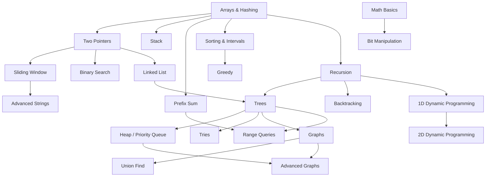

# Content

The problem bank is built as a **learning network**: topics with prerequisites, and inside each topic a ladder of problems from Easy to Hard, ordered by concept. Every practice mode (path, topic drill, mock OA, interview, company set, daily, weak spots) selects from the same data.

Source of truth for the network: `src/js/data/taxonomy.js` (validated by `tests/taxonomy.test.js`). Regenerate the graph and table below with `node scripts/taxonomy-graph.mjs`.

## Two layers

| Layer | What it holds | Where | Rule |
|---|---|---|---|
| **Index** | Facts about problems: source link, difficulty, topic, concept, lists, company signals | `content/index/` | Collect broadly. No statements, examples or tests copied from other platforms |
| **Content** | What the app runs: our own statement, 15 tests, 3 solutions | `src/js/problems/<id>.js` | Original writing only. See `docs/PROBLEM_FORMAT.md` |

Why: LeetCode's terms forbid crawling and scraping and forbid competing services, and problem statements are copyrighted. The site deploys publicly. A problem in the index points at an idea; the content layer re-expresses that idea in our own words and tests (e.g. `pair-sum-target`, not "Two Sum").

## Index record

One record per problem idea, in `content/index/problems.json`:

```json
{
  "id": "pair-sum-target",
  "topic": "arrays-hashing",
  "concept": "complement-lookup",
  "rating": 2,
  "difficulty": "Easy",
  "estMinutes": 15,
  "references": [
    { "platform": "leetcode", "number": 1, "title": "Two Sum", "url": "https://leetcode.com/problems/two-sum/" }
  ],
  "lists": ["blind75", "neetcode150", "grind75"],
  "companies": [{ "name": "Google", "frequency": 0.82, "window": "6m" }],
  "status": "indexed"
}
```

| Field | Meaning |
|---|---|
| `topic`, `concept` | Place in the network. `concept` must be one of the topic's concepts |
| `rating` | 1-10, finer than difficulty so a ladder can be ordered. Bands: Easy 1-3, Medium 4-7, Hard 8-10 |
| `estMinutes` | Used by Mock OA and Interview to fit a time budget |
| `references` | Links only. Used for attribution and for "solve the original too" |
| `lists` | Membership in well-known curated lists |
| `companies` | Signal for prioritization and Company Set mode. Internal use until we decide how to publish it |
| `status` | `indexed` -> `selected` -> `authored` -> `verified`. Only `verified` ships |

## Sources

| Source | Take | Allowed |
|---|---|---|
| LeetCode | Link, number, title, difficulty | Link only, no scraping |
| Blind 75 / NeetCode 150 / Grind 75 | Membership | Yes, lists of names |
| Community company-tag datasets on GitHub | Company, frequency, recency | Grey (derived from paid data). Internal prioritization only |
| Contest rating datasets | Numeric difficulty to seed `rating` | Yes, as a number |
| Exercism problem-specifications (MIT) | Statements and canonical tests | Yes, with attribution |
| Interview reports (Israeli companies, etc.) | Topic and difficulty signal | Manual, our own summary |

## Learning network



| Tier | Topic | Easy | Medium | Hard | Concepts (in ladder order) |
|---|---|---|---|---|---|
| 0 | Arrays & Hashing | 4 | 5 | 2 | frequency-count, hash-set-membership, complement-lookup, group-by-key, encode-decode |
| 0 | Math Basics | 3 | 3 | 2 | digit-manipulation, modular-arithmetic, gcd-lcm, prime-sieve, fast-power |
| 1 | Two Pointers | 3 | 4 | 2 | opposite-ends, same-direction, partition-in-place, sort-then-scan |
| 1 | Stack | 2 | 5 | 2 | matching-brackets, simulation, auxiliary-stack-design, monotonic-stack, expression-evaluation |
| 1 | Prefix Sum | 2 | 4 | 2 | prefix-1d, prefix-plus-hashmap, prefix-2d, difference-array |
| 1 | Sorting & Intervals | 2 | 4 | 2 | custom-comparator, merge-intervals, sweep-line, counting-bucket-sort |
| 1 | Bit Manipulation | 3 | 3 | 1 | xor-tricks, masks-and-shifts, counting-bits, bitmask-subsets |
| 1 | Recursion | 2 | 3 | 1 | base-and-step, divide-and-conquer, memoization-intro |
| 2 | Sliding Window | 2 | 5 | 3 | fixed-window, variable-window, window-frequency-map, monotonic-deque |
| 2 | Binary Search | 2 | 5 | 3 | classic-search, lower-upper-bound, rotated-array, search-on-answer, search-2d |
| 2 | Linked List | 3 | 4 | 2 | dummy-node-traversal, reversal, fast-slow-cycle, merge-lists, cache-design |
| 2 | Greedy | 2 | 5 | 3 | local-choice, exchange-argument, interval-scheduling, reach-extension |
| 3 | Trees | 3 | 6 | 3 | dfs-traversal, bfs-level-order, bst-properties, path-problems, construct-serialize |
| 3 | Backtracking | 1 | 5 | 3 | subsets, permutations, combinations-with-pruning, constraint-search |
| 3 | 1D Dynamic Programming | 2 | 6 | 2 | linear-recurrence, take-or-skip, longest-increasing, knapsack-1d |
| 3 | Advanced Strings | 1 | 3 | 3 | expand-around-center, prefix-function, rolling-hash, z-function |
| 4 | Heap / Priority Queue | 1 | 4 | 3 | top-k, k-way-merge, two-heaps, scheduling |
| 4 | Tries | 1 | 2 | 2 | insert-search, prefix-counting, trie-guided-search |
| 4 | Graphs | 1 | 6 | 3 | grid-traversal, adjacency-traversal, cycle-detection, topological-sort, bipartite |
| 4 | 2D Dynamic Programming | 1 | 5 | 4 | grid-paths, two-sequences, knapsack-2d, interval-dp, state-machine |
| 5 | Union Find | 0 | 3 | 2 | connectivity, union-by-rank, offline-queries |
| 5 | Advanced Graphs | 0 | 4 | 4 | dijkstra, bounded-hops-shortest-path, minimum-spanning-tree, dag-dp, zero-one-bfs |
| 5 | Range Queries | 0 | 2 | 3 | fenwick-tree, segment-tree, sparse-table |
| | **Total (194)** | **41** | **96** | **57** | |

## Pipeline

1. **Index**: merge lists and datasets into `content/index/problems.json`, mapping each idea to `topic` + `concept` + `rating`.
2. **Select**: per topic, pick problems to fill the ladder targets above, covering every concept in order.
3. **Author**: write the problem module with `/add-problem`.
4. **Verify**: solutions in every language pass all 15 cases, then flip `status` to `verified`.
