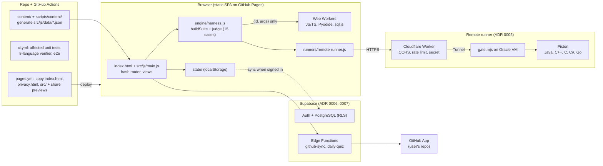

# Repository audit

Date: 2026-11-24. Branch: `chore/repo-polish`. Scope: the whole repository at `d30899c` (main after PR #66).

## What the project is

Leet-For-Berger is a free LeetCode / HackerRank style practice site for coding interviews and take-home tests. You pick a problem, write a solution in one of 8 languages in a Monaco editor, and it is judged against exactly 15 test cases (5 visible, 10 hidden). JavaScript, TypeScript, Python and SQL run inside the browser; Java, C++, C, C# and Go run on a small remote runner. Around the judge sit a learning path, a zoomable Problem Map of 26 topics, company problem sets (including Israeli companies), a daily challenge, a multiple-choice quiz with a daily leaderboard, interview and battle modes, and optional accounts that sync progress and push solutions to GitHub.

It is a static single-page app (vanilla ES modules, no framework, no bundler) deployed to GitHub Pages at <https://royc4515.github.io/leet-for-berger/> (HTTP 200 on 2026-11-24).

## Architecture



The judge (`src/js/engine/harness.js`) is pure: it builds the 15 cases, hands workers only `{ id, args }`, and judges the raw outputs itself, so expected values and hidden case data never reach user code or the UI. The same native test programs (`src/js/engine/programs/`) are used by the remote runner and by the CI verifier, so a solution that passes CI passes on the site. Content (problem index, ladders, company data) lives in `content/` and is turned into the JSON the site reads by scripts in `scripts/content/`.

## Stack and versions

| Area | What | Version (where verified) |
|---|---|---|
| Runtime for tooling | Node.js | `>=20` (`package.json` engines); CI uses 22; this audit ran 22.23.5, npm 10.9.9 |
| App | Vanilla JS ES modules, HTML, CSS | no build step (ADR 0001) |
| Editor | Monaco | 0.52.2 (CDN, pinned, `tests/cdn-pins.test.js`) |
| Python in browser | Pyodide | 0.27.2 (CDN) |
| SQL in browser | sql.js (SQLite wasm) | 1.13.0 (CDN and devDependency) |
| Accounts | supabase-js | 2.118.0 (CDN) |
| Dev dependencies | Playwright `^1.49.0`, TypeScript 5.6.3, sql.js 1.13.0 | `package.json` |
| CI toolchains | Java 21 (Temurin), Go 1.23, .NET 8.0, gcc/g++, Python 3 | `.github/workflows/ci.yml` |
| Remote runner | Cloudflare Worker (`deploy/cloudflare-worker`), Piston on a VM (`deploy/piston`) | `wrangler.toml`, `docker-compose.yml` |
| Backend | Supabase Auth, PostgreSQL (`db/schema.sql`), Edge Functions (Deno) | `deploy/supabase/` |

### How to run

```bash
npm install          # only dev tools: Playwright, TypeScript, sql.js
npm run dev          # http://localhost:5173
npm test             # unit tests
npm run test:e2e     # Playwright smoke test (zero console errors)
npm run check        # both
```

### Baseline results

| Check | Result |
|---|---|
| `VERIFY_LANGUAGES=none node --test` (every unit test file except the native program builder) | 2282 tests: 2083 pass, 0 fail, 199 skipped (language verifier off), 1 min 54 s |
| Full `npm test` | not finished locally: with every toolchain present it compiles every solution in 8 languages and passed the 10-minute limit; CI runs the verifier per language in parallel |
| `npm run test:e2e` (`PW_EXECUTABLE` pointed at the preinstalled Chromium) | 66 of 66 checks pass, zero console errors, 3 min |
| Relative links in 42 tracked markdown files (excluding problem statements) | 0 broken |
| External links | 15 found; the 10 `github.com` repos confirmed to exist through the GitHub API (github.com itself returns 403 to this sandbox) |
| Secret scan (`git grep` for tokens, keys, `.env` files) | nothing committed. `src/js/config.js` holds the Supabase publishable anon key, public by design (RLS guards data; `tests/account.test.js` asserts it is not a secret key) |

## Findings

| # | Severity | Finding |
|---|---|---|
| F1 | high | **No license.** `package.json` says `UNLICENSED` and there is no `LICENSE` file, so the public repo is "all rights reserved" by default. Some solution files are adapted from `doocs/leetcode` under CC BY-SA 4.0 (`THIRD_PARTY_NOTICES.md`), which constrains what license those files can carry. Owner decision. |
| F2 | high | **README is outdated and thin.** Says Java, C++, C, C# and Go are "editor-only until the server runner", but the runner is live (`src/js/config.js` has its URL). Has no live demo link, screenshot, badges, architecture or project structure. Docs list misses ADRs 0004-0010, DESIGN, PLAN and the deploy guides. |
| F3 | medium | **GitHub metadata incomplete.** No homepage URL (Pages is live), no topics, no license detected. |
| F4 | medium | **`docs/ROADMAP.md` last changed 2026-11-18** and still describes Phase 0 as "this release" with Java editor-only, while `docs/PLAN.md` (2026-11-24) is the real living plan. Two plans that disagree. |
| F5 | medium | **Finished one-off planning docs sit beside the living docs**: `docs/DESIGN_PLAN.md` (stage F5, "waiting for approval", shipped as PRs #33-#42), `docs/F6_PLAN.md` (every step ticked), `docs/REDESIGN_BRIEF.md` (says "not started", but F6 shipped). Useful history, confusing as current docs. |
| F6 | low | `.gitignore` misses outputs the repo's own scripts create: `_site/` (`pages.yml`, `build-share-pages.mjs --out`), `share-sample/` (CI share preview step), `.wrangler/` (Wrangler local state in `deploy/cloudflare-worker`). |
| F7 | low | `THIRD_PARTY_NOTICES.md` lists Inter and JetBrains Mono but not Bricolage Grotesque, which is shipped (`src/fonts/bricolage-grotesque-latin.woff2`, OFL 1.1, documented only in `src/fonts/README.md`). |
| F8 | low | No `CONTRIBUTING.md` and no issue templates. The rules exist but only in `CLAUDE.md`, which reads as an agent manual. |
| F9 | low | `CHANGELOG.md` (106 KB) has only 3 PR links; entries are grouped by topic under one huge Unreleased section. Not changing history in this pass; new entries can link PRs. |
| F10 | info | Em dashes: only in validators that reject them (`src/js/modes/quiz.js:334`, two tests). Correct as is. |
| F11 | info | No committed build output, no dead code found at file level, naming is consistent (kebab-case files, problem id = folder name, enforced by tests). |
| F12 | low | `analytics()` in `src/js/modes/interview.js` reads `Date.now()` for a still-running session with no `now` override, against invariant 6. Not changed here (behavior pass, not a fix pass); one-line fix: add a `now = Date.now()` parameter. |

## Structure: keep it, with small moves

The layout already follows the stack and is enforced by tooling, so a big reshuffle would add risk with no gain:

- `tests/` is flat on purpose: `scripts/ci/affected.mjs`, `tests/ci-affected.test.js` and `ci.yml` (`ls tests/*.test.js`) read it non-recursively to pick affected tests. Splitting it into `tests/problems/` and `tests/unit/` would mean rewriting the CI selection and ~280 import paths for no behavior change.
- `index.html`, `privacy.html` and `src/` must stay at the root: `pages.yml` copies exactly those, and the hash router and relative worker URLs assume it.
- `src/js/problems/<id>/` is one folder per problem with the id as the folder name, enforced by `tests/catalog.test.js`.

### Before / after

```text
Before                                  After
docs/                                   docs/
  ARCHITECTURE.md                         ARCHITECTURE.md
  DEPLOY_*.md                             DEPLOY_*.md
  DESIGN.md                               DESIGN.md
  DESIGN_PLAN.md            ----+         PLAN.md
  F6_PLAN.md                ----+         PROBLEM_FORMAT.md
  PLAN.md                       |         REPO_AUDIT.md            (new)
  PROBLEM_FORMAT.md             |         ROADMAP.md               (refreshed)
  REDESIGN_BRIEF.md         ----+         adr/
  ROADMAP.md                    |         assets/screenshot-*.png  (new, README images)
  adr/                          +----->   archive/
  research/                                 DESIGN_PLAN.md
                                            F6_PLAN.md
                                            REDESIGN_BRIEF.md
                                          research/
.github/                                .github/
  pull_request_template.md                pull_request_template.md
  workflows/                              ISSUE_TEMPLATE/{bug_report,feature_request}.md, config.yml (new)
                                          workflows/
(root)                                  (root)
  README.md                               README.md                (rewritten)
                                          CONTRIBUTING.md          (new)
                                          LICENSE                  (new, owner picks)
  .gitignore                              .gitignore               (+ _site/, share-sample/, .wrangler/)
```

Everything else stays where it is.

## Planned moves, renames and deletions

| Action | Path | Reason |
|---|---|---|
| move (`git mv`) | `docs/DESIGN_PLAN.md` -> `docs/archive/DESIGN_PLAN.md` | Stage F5 plan, shipped; history, not a current doc |
| move (`git mv`) | `docs/F6_PLAN.md` -> `docs/archive/F6_PLAN.md` | Stage F6 plan, every step done |
| move (`git mv`) | `docs/REDESIGN_BRIEF.md` -> `docs/archive/REDESIGN_BRIEF.md` | One-off agent prompt for F6, executed |
| update refs | `CLAUDE.md`, `docs/PLAN.md`, `docs/DESIGN.md`, `docs/adr/0010-*.md`, `docs/research/*.md`, archived files, comment in `src/js/ui/views/workspace.js` | Keep every link to the moved files working (`CHANGELOG.md` entries stay as written: they record history) |
| add | `docs/archive/README.md` | One line per archived file: what it was and when it shipped |
| edit | `.gitignore` | F6 |
| edit | `THIRD_PARTY_NOTICES.md` | F7 |
| delete | none | Nothing dead or generated is committed |

Not planned, and why: no `.env.example`. Nothing in the repo reads a `.env` file; the site's config is public and lives in `src/js/config.js`, and server secrets are set with `wrangler secret put` and `supabase secrets set` (`docs/DEPLOY_RUNNER.md`, `docs/DEPLOY_AUTH.md`). The README will list the few environment variables the dev scripts read instead.

## Outcome (phase 2 and 3)

| Finding | Resolution |
|---|---|
| F1 | MIT `LICENSE`; `package.json` license set; exception for adapted files stated in `THIRD_PARTY_NOTICES.md` and the README |
| F2 | README rewritten from verified facts |
| F3 | Values proposed in the PR; applying them needs the owner (`gh repo edit`, see the PR) |
| F4 | `ROADMAP.md` ticks updated from `PLAN.md`, with PR links |
| F5 | Moved to `docs/archive/` with an index; rule added to `CLAUDE.md` |
| F6, F7 | Fixed |
| F8 | `CONTRIBUTING.md` and issue templates added |
| F9 | Left for the owner |
| F12 | Fixed in a follow-up PR (`analytics(session, now)`, unit-tested) |
